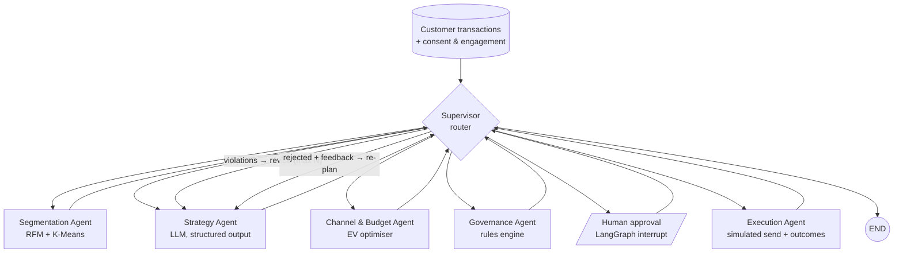

# 🎯 CampaignPilot

**Multi-agent AI system that plans, governs and executes marketing campaigns — with data-driven segmentation, an LLM strategist, a budget optimiser, a rule-based governance layer and human-in-the-loop approval.**

[](https://github.com/AakashRanjan1811/CampaignPilot/actions/workflows/ci.yml)


> On 10 simulated datasets (2,000 customers each, same ₹250 budget), CampaignPilot earned **~2.1× the profit of rule-based RFM targeting and ~2.8× a blanket-discount campaign, with zero policy-breaching contacts**. See [Evaluation](#-evaluation).

---

## Why

Marketing teams want LLMs to help decide *who* to target, *with what* offer, *on which* channel. But an LLM alone will happily give 35% off to your best customers, message people who opted out, or blow the budget. CampaignPilot splits the problem the way a real team would:

| Concern | Who decides | How |
|---|---|---|
| Who are our customers? | **Segmentation Agent** | RFM features → K-Means (k chosen by silhouette score) |
| What should we offer each segment? | **Strategy Agent** | LLM (Llama 3 via Groq / Ollama), schema-validated output |
| Which channel, and who gets the budget? | **Channel & Budget Agent** | Expected-value optimiser over consented, rested customers |
| Is it allowed? | **Governance Agent** | Deterministic rules engine, re-verifies every customer |
| Should we ship it? | **Human reviewer** | LangGraph `interrupt` — approve, reject, or reject with feedback |
| What happened? | **Execution Agent** | Simulated dispatch + outcome model + full audit log |

**LLMs propose, rules decide, humans approve.**

## 🏗 Architecture



- **Supervisor pattern:** every agent returns to a deterministic supervisor that reads the shared state and routes to the next agent. Routing is a pure function and is unit-tested on its own.
- **Self-correction loop:** governance violations go back to the Strategy Agent as structured feedback. After `MAX_REVISIONS`, still non-compliant segments are **blocked** (fail-safe), not sent.
- **Human in the loop:** the graph pauses with `interrupt()` and is resumed with `Command(resume=...)`. Checkpointing keeps state across the pause.
- **Audit trail:** every agent appends a timestamped entry; it is downloadable from the dashboard.

## 📊 Evaluation

`python -m eval.evaluate --seeds 10` — every method gets the same data, budget and outcome simulator.

| Method | Conversions | Conversion rate | Profit (₹) | ROI on spend | Policy-breaching contacts |
|:--|--:|:--|:--|:--|--:|
| Blanket 20% off by email | 85.1 | 8.5% ± 1.2 | 33,651 ± 4,594 | 1.23× | 454.2 |
| Static RFM rules (10%/20% off) | 88.2 | 8.8% ± 1.1 | 45,499 ± 4,938 | 2.62× | 0 |
| Agents **without** governance (ablation) | 138.0 | 13.8% ± 1.1 | 97,868 ± 9,448 | 12.73× | 270.8 |
| **CampaignPilot (full)** | **141.9** | **14.2% ± 1.4** | **93,873 ± 10,571** | **6.15×** | **0** |

*Strategist: offline mock planner. Mean ± std over 10 seeds. Re-run with `LLM_PROVIDER=groq` to evaluate a real LLM.*

**Reading the results**
- Targeted, segment-specific offers beat discounting everyone: discounts are wasted on customers who would buy anyway.
- The ablation shows the **cost of governance**: removing it gains ~4% profit but sends 271 messages that break consent, frequency-cap or discount policy. Governance makes the system shippable.
- ROI is profit divided by total spend (messages + incentives).

**Methodology & limitations (be honest about these)**
- Data is synthetic: six hidden customer personas generate transactions. Agents never see the personas; only the outcome simulator does, which plays the role of the market.
- The outcome model (persona × offer × channel engagement × fatigue) is a simplification; a real deployment would measure uplift with A/B holdouts.
- The table above uses the deterministic mock strategist so it is reproducible in CI. LLM results will vary by model.

## 🚀 Quick start

```bash
git clone https://github.com/AakashRanjan1811/CampaignPilot.git
cd CampaignPilot
python -m venv .venv
# Windows:  .venv\Scripts\activate      macOS/Linux:  source .venv/bin/activate
pip install -r requirements.txt
cp .env.example .env          # Windows: copy .env.example .env
streamlit run app.py          # http://localhost:8501
```

Works **offline out of the box** with the mock strategist. To use a real LLM:

| Provider | Setup |
|---|---|
| **Groq** (free, fast) | Get a key at [console.groq.com/keys](https://console.groq.com/keys), set `LLM_PROVIDER=groq` and `GROQ_API_KEY=...` in `.env` (or paste the key in the sidebar) |
| **Ollama** (local) | `ollama pull llama3.2:3b`, set `LLM_PROVIDER=ollama` |

### REST API

```bash
uvicorn api.main:app --reload        # docs at http://localhost:8000/docs
curl -X POST localhost:8000/campaigns -H "Content-Type: application/json" -d '{"n_customers": 2000, "seed": 7}'
curl -X POST localhost:8000/campaigns/<run_id>/decision -H "Content-Type: application/json" -d '{"approved": true}'
```

### Docker

```bash
docker build -t campaignpilot .
docker run -p 8501:8501 --env-file .env campaignpilot        # dashboard
docker run -p 8000:8000 --env-file .env campaignpilot api    # API
```

### Deploy on Streamlit Community Cloud
Push the repo, create an app pointing at `app.py`, and add `GROQ_API_KEY` and `LLM_PROVIDER = "groq"` under **Settings → Secrets**.

### Real data
Upload the public [UCI Online Retail](https://archive.ics.uci.edu/dataset/352/online+retail) file in the sidebar. Consent and engagement fields don't exist in that dataset, so they are simulated with a fixed seed.

## 🧪 Tests

```bash
pip install -r requirements-dev.txt
pytest            # 53 tests, fully offline
ruff check .
```

Covers RFM maths, persona recovery (>90% cluster purity), every governance rule, budget/consent invariants, supervisor routing, the revise loop, fail-safe blocking with a "stubborn" LLM, human reject-with-feedback, LLM retry logic, the REST API and the Streamlit dashboard. CI runs on Python 3.11 and 3.12.

## 📁 Project structure

```
campaignpilot/
  config.py            settings from env / .env
  data.py              synthetic generator + UCI loader
  segmentation.py      RFM, K-Means, silhouette model selection, segment naming
  schemas.py           Pydantic contracts between agents
  catalog.py           channels, costs, offers, banned phrases
  llm.py               Groq / Ollama / Mock behind one structured-output interface
  simulator.py         outcome model (the "market")
  graph.py             LangGraph supervisor, nodes, checkpointing, runner
  agents/
    strategy.py        LLM strategist (prompt + payload)
    channel.py         channel choice + budget allocation
    governance.py      rules engine
    execution.py       dispatch + results
api/main.py            FastAPI service
app.py                 Streamlit dashboard
eval/evaluate.py       baseline comparison
tests/                 pytest suite
docs/DESIGN.md         design decisions & trade-offs
```

## 🧭 Design decisions

See [docs/DESIGN.md](docs/DESIGN.md) for why each choice was made (why not let the LLM do segmentation, why a deterministic supervisor, why governance is rules not an LLM judge, how prompt injection is handled, and what would change in production).

## License

MIT
